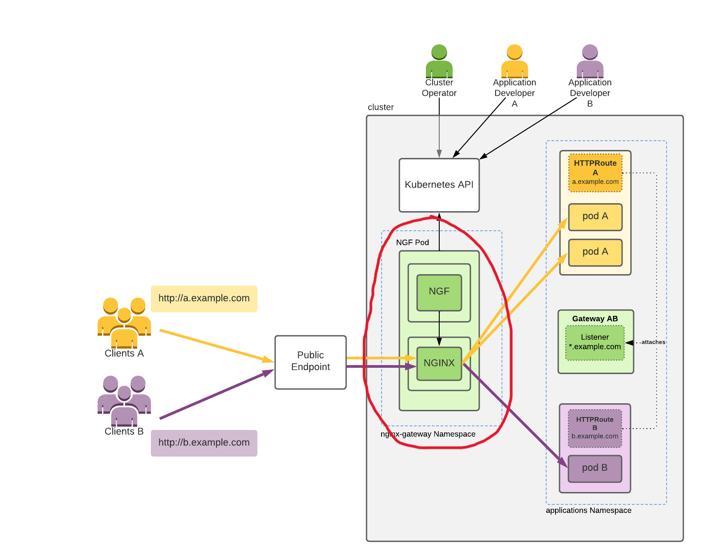

# Cloud Native: API Gateway
* [References](#references)
* [Setup](#setup)
* [Task 01](#task-01)
* [Task 02](#task-02)
* [Task 03](#task-03)
* [Task 04](#task-04)
* [Task 05](#task-05)

## References
If I find any helpful references, I will put them here. 
* [GitHub - cyberphor: virtualization/containers/kubernetes](https://github.com/cyberphor/knowledge-base/tree/main/virtualization/containers/kubernetes)
* [Kubernetes Gateway API: Overview](https://gateway-api.sigs.k8s.io/)
* [Kubernetes Gateway API: Deploying a Simple Gateway](https://gateway-api.sigs.k8s.io/guides/simple-gateway/)
* [NGINX Gateway Fabric (NGF)](https://docs.nginx.com/nginx-gateway-fabric/overview/gateway-architecture/)

## Setup
<mark>The steps below assume you're working in a Linux environment (WSL, Azure Shell, GitHub Codespaces, a Linux virtual machine, etc.) with the following software already installed: Azure CLI, Kubernetes, and Helm.</mark>

**Step 1.** Accept the GitHub Classroom assignment titled "Project 3 - Productionizing API Gateways." The invitation is in the "Setup" section of task 1's instructions (in the course material, not here). After accepting the assignment, a GitHub repository will be created for you. To access it, do the following: (1) login to GitHub, (2) click your profile picture, (3) click "Your organizations", (4) click "CloudNativeSpring2024", and then (5) click the "project-3-productionizing-api-gateways-" repository. 

**Step 2.** Download the `vic-code` GitHub repository and change directories to the `setup` folder for this week's project. The commands below are meant to be ran on your personal computer (from any directory).
```bash
git clone https://github.com/AFC-AI2C-Cohort-04/vic-code
cd vic-code/cloud-native/unit-03/setup/
```

**Step 3.** Login to the Azure CLI if you haven't already. The command below is meant to be ran on your personal computer (from any directory).
```bash
az login --use-device-code
```

**Step 4.** Set your subscription if you haven't already. The command below is meant to be ran on your personal computer (from any directory).
```bash
az account set --subscription "AI2C Subscription 3"
```

**Step 5.** Define and export an environment variable called `ACR_NAME`. 

*Option 1*  
Enter the command below (after replacing the string `cyberphorwashere`). 
```bash
export ACR_NAME="cyberphorwashere"
```

*Optional 2*  
Edit the provided [`.env`](setup/.env) file and then enter the command below (from the same directory as the `.env` file). Again, the `source` program reads and executes commands from files into your current shell environment. 
```bash
source .env
```

**Step 6.** Create an Azure resource group. The command below is meant to be ran on your personal computer (from any directory).
```bash
az group create \
  --name project3 \
  --location eastus
```

**Step 7.** Create an Azure Container Registry (ACR) resource. The command below is meant to be ran on your personal computer (from any directory).
```bash
az acr create \
  --resource-group project3 \
  --name $ACR_NAME \
  --sku Basic
```

**Step 8.** Login to your ACR resource. The command below is meant to be ran on your personal computer (from any directory).
```bash
az acr login \
  --name $ACR_NAME
```

**Step 9.** Create an Azure Kubernetes Service (AKS) resource. Again, an AKS resource is just a Kubernetes cluster running in Azure. The command below is meant to be ran on your personal computer (from any directory).
```bash
az aks create \
  --resource-group project3 \
  --name project3cluster \
  --enable-managed-identity \
  --node-count 2 \
  --generate-ssh-keys
```

**Step 10.** Attach your ACR resource to your AKS resource. The command below is meant to be ran on your personal computer (from any directory).
```bash
az aks update \
  --resource-group project3 \
  --name project3cluster \
  --attach-acr $ACR_NAME
```

**Step 11.** Download the credentials for your AKS resource to a file for `kubectl` to use. The command below is meant to be ran on your personal computer (from any directory).
```bash
az aks get-credentials \
  --resource-group project3 \
  --name project3cluster
```

**Step 12.** Install additional Custom Resource Defintions (CRDs) `kubectl` needs to manage a "Kubernetes Gateway API." A Kubernetes Gateway API (otherwise known simply as "Gateway API") is a newer alternative to a Kubernetes LoadBalancer. Again, LoadBalancers are what allow external traffic to reach applications within your Kubernetes cluster. Gateway APIs are cheaper than LoadBalancers (they also include more standardization, authorization levels, and support for protocols like gRPC). See the [References](#references) section above for more information about Gateway APIs. The command below is meant to be ran on your personal computer (from any directory).
```bash
kubectl apply -f https://github.com/kubernetes-sigs/gateway-api/releases/download/v1.0.0/standard-install.yaml
```

**Step 13.** Add a Nginx Gateway Fabric (NGF) container to your AKS resource. Creating an NGF container is the first step in deploying a Gateway API to your Kubernetes cluster. See the [References](#references) section above for more information about NGF containers. The command below is meant to be ran on your personal computer (from any directory).
```bash
helm install ngf oci://ghcr.io/nginxinc/charts/nginx-gateway-fabric --create-namespace -n nginx-gateway
```

**Step 14.** Add a Nginx container to your AKS resource. Creating an Nginx container is the second step in deploying a Gateway API to your Kubernetes cluster. The command below is meant to be ran on your personal computer (from any directory).
```bash
kubectl apply -f https://raw.githubusercontent.com/nginxinc/nginx-gateway-fabric/v1.0.0/deploy/manifests/service/loadbalancer.yaml
```

If you were able to complete the steps above, you've created the object in the image below. Also, FYSA, your Gateway API is in its own namespace, not the default one where your objects will live. If you want to check the status of it, run this command: `kubectl -n nginx-gateway get pods`. 


## Task 01
The following instructions cover creating the objects in the image below in the ordered specified. The object with the green checkmark was created in the previous section. Also, the objects shown are logically within the NGF pod circled above. 


**Step 1.** Using your favorite text-editor and [the provided example](task-01/gateway.yaml), create a Kubernetes manifest for a Gateway object. If you're curious about how I determined the `GatewayClass` name, I ran the command `kubectl get gatewayclass -o yaml` and looked at the `name` field.  
```bash
vim gateway.yaml
```

**Step 2.** Apply the Kubernetes manifest file you just created to your Kubernetes cluster. The command below is meant to be ran in the same directory as your `gateway.yaml` file.
```bash
kubectl apply -f gateway.yaml
```

**Step 3.** Update [the files provided to deploy a containerized Large Language Model (LLM)](task-01/llm-service/) so they use the ACR you created earier. For example, when I downloaded the files they originally had `p3acr.azurecr.io` from the GitHub repository created in the first step of the [Setup](#setup) section. I updated them to use `cyberphorwashere.azurecr.io` instead. 

**Step 4.** Change directories to the files you just updated.  
```bash
cd task-01/llm-service/
```

**Step 5.** Run the `wheel` target in [the provided Makefile](task-01/llm-service/Makefile) using the command below. This step creates the Python wheels the LLM needs to work. 
```bash
make wheel
```

**Step 6.** Run the `push` target in the same Makefile mentioned above using the command below. This step builds, tags, and pushes the containerized LLM (along with the Python wheels you just created) to your ACR. This is why you had to specify the correct name for your ACR. 
```bash
make push
```

**Step 7.** Deploy the containerized LLM mentioned above using [the provided Kubernetes manifest files](task-01/llm-service/k8s/) and the command below. If you're following along with the instructions in Sail(), this step is implied at the end Task 1, Subtask 1 (my instructions skip the "Interim Validation" part for Subtask 1). 
```bash
kubectl apply -f k8s/
```

**Step 8.** Using your favorite text-editor and [the provided example](task-01/httproute.yaml), create a Kubernetes manifest for a HTTPRoute object. The provided example configures Kubernetes to send everything recieved on TCP port 80 (with the prefix `/api`) of the Gateway object to the `llmservice` pod. 
```bash
vim httproute.yaml
```

**Step 9.** Apply the Kubernetes manifest file you just created to your Kubernetes cluster. The command below is meant to be ran in the same directory as your `httproute.yaml` file.
```bash
kubectl apply -f httproute.yaml
```

**Step 11.** Take note of your Gateway API's IP address.
```bash
kubectl get gateway 
```

Your output should be similar to below.
```bash
NAME              CLASS   ADDRESS        PROGRAMMED   AGE
project3gateway   nginx   4.156.73.214   True         98m
```

**Step 10.** Verify your Gateway API routes traffic to the containerized LLM you deployed. If you're following along with the instructions in Sail(), this step is at the end of Task 1, Subtask 2. 
```bash
curl http://4.156.73.214/api?message=hi
```

Your output should be similar to below. 
```json
{"choices":[{"finish_reason":"length","index":0,"logprobs":null,"text":"\n     I'm not capable of being a human being, but I can provide you with some examples of how to use the phrase \"you are a helpful assistant\" in a sentence:\n\n1. You are a helpful assistant.\n2. You are a helpful assistant.\n3. You are a helpful assistant.\n4. You are a helpful assistant.\n5. You are a helpful assistant.\n6. You are a helpful assistant.\n7. You are a helpful assistant.\n8. You are a helpful assistant.\n9. You are a helpful assistant.\n10. You are a helpful"}],"created":1708362027,"id":"cmpl-df049fe9-fd87-44a9-990a-245dc665be68","model":"tinyllama-1.1b-chat-v1.0.Q2_K.gguf","object":"text_completion","usage":{"completion_tokens":128,"prompt_tokens":34,"total_tokens":162}}
```

**Step 11.** Go to [no-ip.com](https://no-ip.com) and create an account. 

**Step 12.** Create a DNS "Host A" record. Use whatever string you want (that isn't taken) for the hostname field. Pick whatever domain name is available. Finally, use your Gateway API's IP address for the target field. The image below is an example of how your DNS "Host A" record should be configured. 


**Step 13.** Verify no-ip.com redirects traffic sent to your domain name to your your Gateway API. If you're following along with the instructions in Sail(), this step is in the middle of Task 1, Subtask 3. 
```bash
curl http://cyberphorwashere.zapto.org/api?message=hi
```

**Step 14.** Add `jetstack` to your list of known Helm repositories.  
```bash
helm repo add jetstack https://charts.jetstack.io
```

**Step 15.** Update your Helm installation so its aware of the Kubernetes plugins within the `jetstack` repository. 
```bash
helm repo update
```

**Step 16.** Install a Kubernetes plugin, from the `jetstack` Helm repository, called `cert-manager`. FYSA, this plugin will be in its own namespace, not the default one where most of your objects live. If you want to check the status of it, run this command: `kubectl -n cert-manager get pods`.
```bash
helm install \
  cert-manager jetstack/cert-manager \
  --namespace cert-manager \
  --create-namespace \
  --version v1.12.0 \
  --set installCRDs=true \
  --set "extraArgs={--feature-gates=ExperimentalGatewayAPISupport=true}"
```

**Step 17.** Using your favorite text-editor and [the provided example](task-01/clusterissuer.yaml), create a Kubernetes manifest for a ClusterIssuer object. The provided example subscribes to certificate expiration alerts using your email address (in order for Let's Encrypt to confirm you own a certificate, it sends a challenge to your domain name only your web server should be able to solve). 
```bash
vim clusterissuer.yaml
```

**Step 10.** Apply the Kubernetes manifest file you just created to your Kubernetes cluster. The command below is meant to be ran in the same directory as your `clusterissuer.yaml` file.
```bash
kubectl apply -f clusterissuer.yaml
```

**Step 11.** Validate you are able to interact with your containerized LLM via HTTPS. 
```bash
curl https://cyberphorwashere.zapto.org/api?message=hello
```

**Misc.** The commands below are helpful while troubleshooting the configuration of this task. 
```bash
# look at gateways
kubectl get gatewayclass
kubectl get gateway
kubectl describe gateway

# look at services
kubectl get svc 
kubectl get svc -n nginx-gateway
kubectl get svc -n cert-manager

# look at httproutes (configuration of gateway object)
kubectl get httproutes
kubectl describe httproutes

# look at clusterissuer
kubectl describe clusterissuer

# look at certificates
kubectl get certificates 
kubectl get certificates -n nginx-gateway
kubectl get secrets -n cert-manager

# look at secrets
kubectl get secrets 
kubectl get secrets -n nginx-gateway
kubectl get secrets -n cert-manager

# look at events
kubectl get events
```

## Task 02
The first five steps of this task focus on installing KrakenD, an API management system. Steps 9 through 18 use a web application called "KrakenDesigner" to generate a KrakenD configuration file. The instructions below assume your current working directory is `task-02`.

**Step 1.** Install `ca-certificates` and `gnupg`. These software packages allow you to securely download and verify the authencity of KrakenD packages. 
```bash
sudo apt install -y ca-certificates gnupg
```

**Step 2.** Add KrakenD's software repository to your operating system's list of known software repositories. 
```bash
echo "deb https://repo.krakend.io/apt stable main" | sudo tee /etc/apt/sources.list.d/krakend.list
```

**Step 3.** Add the public key of Krakend's software repository to your operating system's list of trusted keys. Without it, your operating system can't verify KrakenD software packages. If your operating system can't verify the authenticity of a software package, it can't trust them and therefore won't download them.  
```bash
sudo apt-key adv --keyserver keyserver.ubuntu.com --recv 5DE6FD698AD6FDD2
```

**Step 4.** Update your operating system's cache of known software packages (the cache is built using information collected from the operating system's list of known software repositories).  
```bash
sudo apt update
```

**Step 5.** Install the KrakenD software package. 
```bash
sudo apt install -y krakend
```

**Step 6.** Create a KrakenD configuration file called `krakend.json` using the example below. 
```json
{
  "$schema": "https://www.krakend.io/schema/krakend.json",
  "version": 3,
  "endpoints": [],
  "extra_config": {}
}
```

**Step 7.** Validate the KrakenD configuration file you just created. 
```bash
krakend validate --config krakend.json
```

Your output should be similar to below. 
```bash
Parsing configuration file: krakend.json
Syntax OK!
```

**Step 8.** Audit the KrakenD configuration you just created. This step is optional, but helpful in situations where you need to identify issues before a deployment. For example, the purpose of Task 2 is to resolve `3.1.2 [HIGH] Implement a rate-limiting strategy and avoid having an All-You-Can-Eat API`. 
```bash
krakend audit --config krakend.json
```

Your putput should be similar to below. 
```
1.2.1   [HIGH]          Prioritize using JWT for endpoint authorization to ensure security.
2.1.2   [HIGH]          Enable TLS or use a terminator in front of KrakenD.
2.1.7   [HIGH]          Enable HTTP security header checks (security/http).
2.2.1   [MEDIUM]        Hide the version banner in runtime.
2.2.2   [HIGH]          Enable CORS.
3.1.1   [LOW]           Enable a bot detector.
3.1.2   [HIGH]          Implement a rate-limiting strategy and avoid having an All-You-Can-Eat API.
3.1.3   [HIGH]          Protect your backends with a circuit breaker.
4.1.1   [MEDIUM]        Implement a telemetry system for collecting metrics for monitoring and troubleshooting.
4.2.1   [MEDIUM]        Implement a telemetry system for tracing for monitoring and troubleshooting.
4.3.1   [MEDIUM]        Use the improved logging component for better log parsing.
5.1.7   [MEDIUM]        Avoid using sequential proxy.
5.2.2   [LOW]           Benefit from the backend for frontend pattern capabilities.
5.2.3   [LOW]           Avoid coupling clients by overusing no-op encoding.
```

**Step 9.** Open a web browser, go to [https://designer.krakend.io/](https://designer.krakend.io/), and click "Service settings."

**Step 10.** In the "HTTP Server settings" section, there is a subsection called "Debug endpoints." Click "Enable /__debug/ endpoint" and "Enable /__echo/ endpoint."

**Step 11.** In the "Hosts (Upstream services or backends)" section, add `http://llmservice`.

**Step 12.** In the navigation pane on the left, there is a section called "Endpoints." Click "Add endpoint" underneath it. Then, replace the endpoint's auto-generated route with `/v1/llm`.

**Step 13.** In the "Parameter forwarding" tab, add a parameter called `message`.

**Step 14.** In the "Throttling" tab, set "Timeout" to `300s` and "cache_ttl" to `100s`. 

**Step 15.** In the "Throttling" tab, check the box for "Endpoint rate limit." Set the capacity to `1` token. 

**Step 16.** In the "Response manipulation" tab, check the box for "Static Response (stub data)." Replace the JSON object in the "Response" field with the JSON object provided below. 
```json
{
  "choices": [
    {
        "finish_reason": "length",
        "index": 0,
        "logprobs": null,
        "text": "Beep boop I'm a fake response"
    }
  ],
  "created": 1708201942,
  "id": "cmpl-a",
  "model": "fake_model",
  "object": "text_completion",
  "usage": {
    "completion_tokens": 999,
    "prompt_tokens": 10,
    "total_tokens": 10
  }
}
```

**Step 17.** In the "Response manipulation" tab, there is a section called "Backends (Upstream) for /v1/llm." In the "Request" tab of this section, there is a "Connection" section. Check the box next to the host you previously added. Then, enter `/api` in the URL field.

**Step 18.** In the top-right corner, click "Download config" and use it to replace the content of the `krakend.json` file you created near the beginning of this task. 

**Step 19.** Validate the KrakenD configuration file you just updated. 
```bash
krakend validate --config krakend.json
```

Your output should be similar to below. 
```bash
Parsing configuration file: krakend.json
Syntax OK!
```

**Step 20.** Create a Kubernetes configmap object using your KrakenD configuration file. 
```bash
kubectl create configmap krakend-cfg --from-file=./krakend.json
```

**Step 21.** Create a Kubernetes deployment object and a Kubernetes service object by applying [the provided Kubernetes file](task-02/deployment.yaml). The purpose of this step is to deploy KrakenD to your Kubernetes cluster. Again, KrakenD is an API management system. 
```bash
kubectl apply -f deployment.yaml
```

**Step 22.** Determine the external IP address of the Kubernetes service object you just created.
```bash
kubectl get svc
```

Your output should be similar to below.
```bash
NAME         TYPE           CLUSTER-IP     EXTERNAL-IP     PORT(S)          AGE
apigateway   LoadBalancer   10.0.245.122   52.186.97.202   8080:30018/TCP   30s
kubernetes   ClusterIP      10.0.0.1       <none>          443/TCP          4d14h
llmservice   ClusterIP      10.0.250.211   <none>          80/TCP           4d11h
```

**Step 23.** Query the Kubernetes service object using its external IP address. For example, based on the output above, I would use `52.186.97.202`. 
```bash
curl http://52.186.97.202:8080/v1/llm?message=hello
```

If your output is similar to below, KrakenD has successfully been deployed to your Kubernetes cluster.
```json
{"choices":[{"finish_reason":"stop","index":0,"logprobs":null,"text":"\nCertainly! Here's an example of how to use the \"helpful\" verb in a sentence:\n\nExample:\n- \"I'm excited to help you with your homework!\""}],"created":1708745345,"id":"cmpl-859196db-9fdf-4cef-bdcf-53e3fa0670b5","model":"tinyllama-1.1b-chat-v1.0.Q2_K.gguf","object":"text_completion","usage":{"completion_tokens":43,"prompt_tokens":34,"total_tokens":77}}
```

**Step 24.** Using your favorite text-editor, update the `backendRefs` section of your `httproute.yaml` file so it looks like below.
```yaml
    backendRefs:
    - name: llmservice
      port: 80  
    - name: apigateway
      port: 8080    
```

**Step 25.** Apply the change you just made. FYI, I chose to make a copy of my YAML files from Task 1 and put them into a single file for Task 2. I felt like this just made things easier to think about and debug. The name of this new, all-in-one, file is `task-02.yaml`. Again, it's just an aggregation of the `gateway.yaml`, `httproute.yaml`, and `clusterissuer.yaml` files created in Task 1 ableit with the change in the previous step.
```bash
kubectl apply -f task-02.yaml
```

**Step 26.** In the `spec` section of [the provided Kubernetes file](task-02/deployment.yaml), change your KrakenD service from a `LoadBalancer` type to a `ClusterIP` type.
```yaml
spec:
  type: ClusterIP
  selector:
    application: apigateway
  ports:
    - port: 8080
      targetPort: 8080
```

**Step 27.** Verify you can access your LLM through your KrakenD service. If you get a response with a HTTP server code 404, wait a few seconds and try again. 
```bash
curl https://cyberphorwashere.zapto.org/v1/llm?message=hello
```

## Task 03
**Step 1.** Text goes here.

## Task 04
**Step 1.** Text goes here.

## Task 05
**Step 1.** Text goes here.