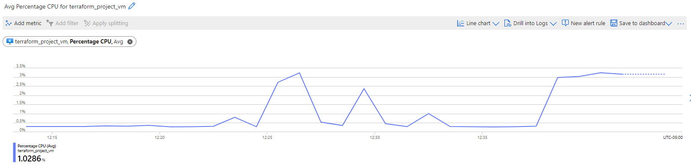
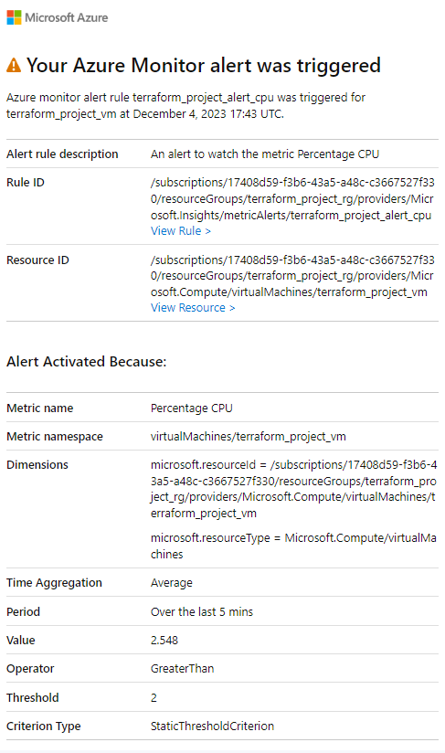

# Infrastructure as Code

## Setup
**Step 1.** Login to Azure and open the Cloud Shell. 

**Step 2.** Create a folder called `terraform_project`. 
```bash
mkdir terraform_project
```

**Step 3.** Change your current working directory the folder you just created. 
```bash
cd terraform_project
```

## Task 1
In this task, you're going to do the following:
* Create and apply a Terraform execution plan (i.e., `main.tf`)
  * The execution plan will deploy a resource group within Azure

**Step 1.** Create a file called `main.tf`. 
```bash
touch main.tf
```

**Step 2.** Add the content below to the file you just created (the code is also [included in this repository](/devops/week-14/task-1/main.tf)).
```hcl
terraform {
    required_providers {
        azurerm = {
            source  = "hashicorp/azurerm"
            version = "=3.0.0"
        }
    }
}

provider "azurerm" {
    features {}
}

resource "azurerm_resource_group" "rg" {
    name = "terraform_project_rg"
    location = "eastus"
    tags = {
        environment = "TF sandbox"
    }
}
```

**Step 3.** Initialize your Terraform configuration. 
```bash
terraform init
```

**Step 4.** Generate a Terraform execution plan and review it. 
```bash
terraform plan
```

**Step 5.** Apply your Terraform execution plan.
```bash
terraform apply
```

## Task 2
In this task, you're going to do the following:
* Update your root module's `main.tf` file
* Add a `variables.tf` file to the root module
* Create and install two child modules (i.e., `vpc` and `vm`)
* Apply the updated Terraform execution plan

**Step 1.** Update your `main.tf` with the content below (the code is also [included in this repository](/devops/week-14/task-2/main.tf)).
```hcl
terraform {
    required_providers {
        azurerm = {
            source  = "hashicorp/azurerm"
            version = "=3.0.0"
        }
    }
}

provider "azurerm" {
    features {}
}

resource "azurerm_resource_group" "rg" {
    name = "terraform_project_rg"
    location = var.location
    tags = {
        environment = "TF sandbox"
    }
}

module "vpc" {
    source              = "./vpc"
    location            = var.location
    resource_group_name = azurerm_resource_group.rg.name
}

module "vm" {
    source               = "./vm"
    location             = var.location
    admin_username       = var.admin_username
    admin_password       = var.admin_password
    resource_group_name  = azurerm_resource_group.rg.name
    public_ip_address    = module.vpc.public_ip_address
    network_interface_id = module.vpc.network_interface_id
}

output "vm_ip" {
    value = module.vpc.public_ip_address
}
```

**Step 2.** Create a file called `variables.tf` in your "terraform_project" folder.
```bash
touch variables.tf
```

**Step 3.** Add the content below to it (the code is also [included in this repository](/devops/week-14/task-2/variables.tf)).
```hcl
variable "location" {
  type = string
  default = "eastus"
}

variable "admin_username" {
  default = "student"
}

variable "admin_password" {
  default = "p@55w0rd"
}
```

**Step 4.** Create a folder called `vpc` within your "terraform_project" folder. 
```bash
mkdir vpc
```

**Step 5.** Change your current working directory to it. 
```bash
cd vpc
```

**Step 6.** Create a file called `main.tf` within your "vpc" folder. 
```bash
touch main.tf
```

**Step 7.** Add the content below to it (the code is also [included in this repository](/devops/week-14/task-2/vpc/main.tf)).
```hcl
resource "azurerm_virtual_network" "vnet" {
    name                = "terraform_project_vnet"
    address_space       = ["10.0.0.0/16"]
    location            = var.location
    resource_group_name = var.resource_group_name
}
    
resource "azurerm_subnet" "subnet" {
    name                 = "terraform_project_subnet"
    resource_group_name  = var.resource_group_name
    virtual_network_name = azurerm_virtual_network.vnet.name
    address_prefixes     = ["10.0.1.0/24"]
}
    
resource "azurerm_public_ip" "publicip" {
    name                         = "terraform_project_public_ip"
    location                     = var.location
    resource_group_name          = var.resource_group_name
    allocation_method            = "Static"
}
    
resource "azurerm_network_security_group" "nsg" {
    name                = "terraform_project_nsg"
    location            = var.location
    resource_group_name = var.resource_group_name
    security_rule {
        name                       = "HTTP"
        priority                   = 103
        direction                  = "Inbound"
        access                     = "Allow"
        protocol                   = "Tcp"
        source_port_range          = "*"
        destination_port_range     = "80"
        source_address_prefix      = "*"
        destination_address_prefix = "*"
    }
    security_rule {
        name                       = "SSH"
        priority                   = 1001
        direction                  = "Inbound"
        access                     = "Allow"
        protocol                   = "Tcp"
        source_port_range          = "*"
        destination_port_range     = "22"
        source_address_prefix      = "*"
        destination_address_prefix = "*"
    }
}
    
resource "azurerm_network_interface" "nic" {
    name                      = "terraform_project_nic"
    location                  = var.location
    resource_group_name       = var.resource_group_name
    ip_configuration {
        name                          = "terraform_project_nic_config"
        subnet_id                     = azurerm_subnet.subnet.id
        private_ip_address_allocation = "Dynamic"
        public_ip_address_id          = azurerm_public_ip.publicip.id
    }

}

resource "azurerm_network_interface_security_group_association" "sg_association" {
  network_interface_id      = azurerm_network_interface.nic.id
  network_security_group_id = azurerm_network_security_group.nsg.id
}

output "public_ip_address" {
    value = azurerm_public_ip.publicip.ip_address
}

output "network_interface_id" {
    value = azurerm_network_interface.nic.id
}
```

**Step 8.** Create a file called `variables.tf` within your "vpc" folder. 
```bash
touch variables.tf
```

**Step 9.** Add the content below to it (the code is also [included in this repository](/devops/week-14/task-2/vpc/variables.tf)).
```hcl
variable "location" {
    type = string
    description = "The location of the vpc resources"
}

variable "resource_group_name" {
    type = string
    description = "The resource group name of the vpc resources"
}
```

**Step 10.** Create a folder called `vm` within your "terraform_project" folder. 
```bash
mkdir vm
```

**Step 11.** Change your current working directory to it. 
```bash
cd vm
```

**Step 12.** Create a file called `main.tf` within your "vm" folder. 
```bash
touch main.tf
```

**Step 13.** Add the content below to it (the code is also [included in this repository](/devops/week-14/task-2/vm/main.tf)).
```hcl
resource "azurerm_virtual_machine" "vm" {
    name                  = "terraform_project_vm"
    location              = var.location
    resource_group_name   = var.resource_group_name
    network_interface_ids = [var.network_interface_id]
    vm_size               = "Standard_DS1_v2"
    storage_os_disk {
        name              = "terraform_project_os_disk"
        caching           = "ReadWrite"
        create_option     = "FromImage"
        managed_disk_type = "Premium_LRS"
    }
    storage_image_reference {
        publisher = "Canonical"
        offer     = "UbuntuServer"
        sku       = "16.04.0-LTS"
        version   = "latest"
    }
    os_profile {
        computer_name  = "terraformProjectVm"
        admin_username = var.admin_username
        admin_password = var.admin_password
    }
    os_profile_linux_config {
        disable_password_authentication = false
    }
    provisioner "remote-exec" {
        connection {
            type = "ssh"
            user = var.admin_username
            password = var.admin_password
            host = var.public_ip_address
        }
        inline = [
            "sudo apt-get -y update",
            "sudo apt-get -y install apache2",
            "echo Welcome to the cloud course! | sudo tee /var/www/html/index.html"
        ]
    }
}
```

**Step 14.** Create a file called `variables.tf` within your "vm" folder. 
```bash
touch variables.tf
```

**Step 15.** Add the content below to it (the code is also [included in this repository](/devops/week-14/task-2/vm/variables.tf)).
```hcl
variable "location" {
    type = string
    description = "The location of the vpc resources"
}

variable "admin_username" {
    type = string
    description = "The username of the admin account to ssh to the VM"
}

variable "admin_password" {
    type = string
    description = "The password of the admin account to ssh to the VM"
}

variable "public_ip_address" {
    type = string
    description = "The public IP address for the VM"
}

variable "resource_group_name" {
    type = string
    description = "The resource group name of the vm resources"
}

variable "network_interface_id" {
    type = string
    description = "The network interface id of the vm resources"
}
```

**Step 16.** Initialize your `vpc` child module.
```bash
cd vpc
terraform init
cd ..
```

**Step 17.** Initialize your `vm` child module.
```bash
cd vm
terraform init
cd ..
```

**Step 18.** Reinitialize your root module (i.e., the "terraform_project" folder). If you don't do this, your child modules will not be installed within your Terraform configuration plan. 
```bash
terraform init
```

**Step 19.** Generate a new Terraform execution plan and review it. 
```bash
terraform plan
```

**Step 20.** Apply your Terraform execution plan.
```bash
terraform apply
```

**Step 21.** Verify your Terraform execution plan worked. 
```bash
curl $(terraform output vm_ip | cut -d'"' -f2)
# Welcome to the cloud course!
```

## Task 3
In this task, you're going to do the following:
* Duplicate your Terraform configuration files so there's two folders: `terraform_project` and `terraform_project_t3`
* Update the new root module in the `terraform_project_t3` folder
* Update the new `vpc` child module in the `terraform_project_t3` folder
* Update the new `vm` child module in the `terraform_project_t3` folder
  * The update will include two conditional statements
    * If the workspace is "prod", do not delete the virtual machine's operating system disk
    * If the workspace is "prod", do not delete the virtual machine's data disk
* Create two Terraform workspaces (i.e. `staging` and `prod`) within the `terraform_project_t3` folder
* Create and apply the updated Terraform configuration plan within each Terraform workspace

**Step 1.** Create a new directory called `terraform_project_t3`.
```bash
cd ~
mkdir terraform_project_t3
```

**Step 2.** Copy everything from `terraform_project` to `terraform_project_t3`.
```bash
cp terraform_project/* terraform_project_t3/
``` 

**Step 3.** Change your current working directory to the new folder you created. 
```bash
cd terraform_project_3
```

**Step 4.** Update the `main.tf` in your root module with the content below (the code is also [included in this repository](/devops/week-14/task-3/main.tf)).
```hcl
terraform {
    required_providers {
        azurerm = {
            source  = "hashicorp/azurerm"
            version = "=3.0.0"
        }
    }
}

provider "azurerm" {
    features {}
}

resource "azurerm_resource_group" "rg" {
    name = "terraform_project_${terraform.workspace}_rg"
    location = var.location
    tags = {
        environment = "TF sandbox"
    }
}

module "vpc" {
    source              = "./vpc"
    location            = var.location
    resource_group_name = azurerm_resource_group.rg.name
}

module "vm" {
    source               = "./vm"
    location             = var.location
    admin_username       = var.admin_username
    admin_password       = var.admin_password
    resource_group_name  = azurerm_resource_group.rg.name
    public_ip_address    = module.vpc.public_ip_address
    network_interface_id = module.vpc.network_interface_id
}

output "vm_ip" {
    value = module.vpc.public_ip_address
}
```

**Step 5.** Update the `main.tf` in your `vpc` module with the content below (the code is also [included in this repository](/devops/week-14/task-3/vpc/main.tf)).
```hcl
resource "azurerm_virtual_network" "vnet" {
    name                = "terraform_project_${terraform.workspace}_vnet"
    address_space       = ["10.0.0.0/16"]
    location            = var.location
    resource_group_name = var.resource_group_name
}
    
resource "azurerm_subnet" "subnet" {
    name                 = "terraform_project_${terraform.workspace}_subnet"
    resource_group_name  = var.resource_group_name
    virtual_network_name = azurerm_virtual_network.vnet.name
    address_prefixes     = ["10.0.1.0/24"]
}
    
resource "azurerm_public_ip" "publicip" {
    name                         = "terraform_project_${terraform.workspace}_public_ip"
    location                     = var.location
    resource_group_name          = var.resource_group_name
    allocation_method = "Static"
}
    
resource "azurerm_network_security_group" "nsg" {
    name                = "terraform_project_${terraform.workspace}_nsg"
    location            = var.location
    resource_group_name = var.resource_group_name
    security_rule {
        name                       = "HTTP"
        priority                   = 103
        direction                  = "Inbound"
        access                     = "Allow"
        protocol                   = "Tcp"
        source_port_range          = "*"
        destination_port_range     = "80"
        source_address_prefix      = "*"
        destination_address_prefix = "*"
    }
    security_rule {
        name                       = "SSH"
        priority                   = 1001
        direction                  = "Inbound"
        access                     = "Allow"
        protocol                   = "Tcp"
        source_port_range          = "*"
        destination_port_range     = "22"
        source_address_prefix      = "*"
        destination_address_prefix = "*"
    }
}

resource "azurerm_network_interface" "nic" {
    name                      = "terraform_project_${terraform.workspace}_nic"
    location                  = var.location
    resource_group_name       = var.resource_group_name
    ip_configuration {
        name                          = "terraform_project_nic_${terraform.workspace}_config"
        subnet_id                     = azurerm_subnet.subnet.id
        private_ip_address_allocation = "Dynamic"
        public_ip_address_id          = azurerm_public_ip.publicip.id
    }

}

resource "azurerm_network_interface_security_group_association" "sg_association" {
    network_interface_id      = azurerm_network_interface.nic.id
    network_security_group_id = azurerm_network_security_group.nsg.id
}

output "public_ip_address" {
    value = azurerm_public_ip.publicip.ip_address
}

output "network_interface_id" {
    value = azurerm_network_interface.nic.id
}
```

**Step 6.** Update the `main.tf` in your `vm` module with the content below (the code is also [included in this repository](/devops/week-14/task-3/vm/main.tf)).
```hcl
resource "azurerm_virtual_machine" "vm" {
    name                  = "terraform_project_${terraform.workspace}_vm"
    location              = var.location
    resource_group_name   = var.resource_group_name
    network_interface_ids = [var.network_interface_id]
    vm_size               = "Standard_DS1_v2"
    storage_os_disk {
        name              = "terraform_project_${terraform.workspace}_os_disk"
        caching           = "ReadWrite"
        create_option     = "FromImage"
        managed_disk_type = "Premium_LRS"
    }
    storage_image_reference {
        publisher = "Canonical"
        offer     = "UbuntuServer"
        sku       = "16.04.0-LTS"
        version   = "latest"
    }
    os_profile {
        computer_name  = "terraformProject${terraform.workspace}Vm"
        admin_username = var.admin_username
        admin_password = var.admin_password
    }
    os_profile_linux_config {
        disable_password_authentication = false
    }
    provisioner "remote-exec" {
        connection {
            type = "ssh"
            user = var.admin_username
            password = var.admin_password
            host = var.public_ip_address
        }
        inline = [
            "sudo apt-get -y update",
            "sudo apt-get -y install apache2",
            "echo Welcome to the cloud course! | sudo tee /var/www/html/index.html"
        ]
    }
    delete_data_disks_on_termination = terraform.workspace == "prod" ? false : true
    delete_os_disk_on_termination    = terraform.workspace == "prod" ? false : true
}
```

**Step 7.** Initialize your new Terraform root module (i.e., `terraform_project_3` folder). 
```bash
terraform init
```

**Step 8.** Create two new Terraform workspaces called `staging` and `prod`.
```bash
terraform workspace new staging
terraform workspace new prod
```

**Step 9.** Select the first workspace you created. 
```bash
terraform workspace select staging
```

**Step 10.** Create an execution plan within the `staging` workspace for the updated Terraform configuration. 
```bash
terraform plan
```

**Step 11.** Apply the execution plan within the `staging` workspace.
```bash
terraform apply
```

**Step 12.** Verify your Terraform execution plan worked. 
```bash
curl $(terraform output vm_ip | cut -d'"' -f2)
# Welcome to the cloud course!
```

**Step 13.** Select the second workspace you created. 
```bash
terraform workspace select prod
```

**Step 14.** Create an execution plan within the `prod` workspace for the updated Terraform configuration. 
```bash
terraform plan
```

**Step 15.** Apply the execution plan within the `prod` workspace.
```bash
terraform apply
```

**Step 16.** Verify your Terraform execution plan worked. 
```bash
curl $(terraform output vm_ip | cut -d'"' -f2)
# Welcome to the cloud course!
```

## Task 4
In this task, you're going to do the following:
* Update the `main.tf` file within your original root module (i.e., `terraform_project`) folder
  * The update will include
    * An Azure Monitor action group 
    * An Azure Monitor alert configuration
* Update and apply your Terraform execution plan

**Step 1.** Change your current working directory to the `terraform_project` folder.
```bash
cd terraform_project
```

**Step 2.** Update the `email_address` field in the content below. Then, append the content to the end of the `main.tf` file within your `vm` child module (the code is also [included in this repository](/devops/week-14/task-4/vm/main.tf)).
```hcl
resource "azurerm_monitor_action_group" "action_group" {
  name                = "terraform_project_action_group"
  resource_group_name = var.resource_group_name
  short_name          = "devopsadmin"
  email_receiver {
    name          = "sendtodevopsadmin"
    email_address = "vf@andrew.cmu.edu"
  }
}

resource "azurerm_monitor_metric_alert" "alert" {
  name = "terraform_project_alert_cpu"
  resource_group_name = var.resource_group_name
  scopes = [azurerm_virtual_machine.vm.id]
  description = "An alert to watch the metric Percentage CPU"
  enabled = true
  criteria {
    metric_namespace = "Microsoft.Compute/virtualMachines"
    metric_name = "Percentage CPU"
    operator    = "GreaterThan"
    threshold   = 2
    aggregation = "Average"
  }
  action {
      action_group_id = azurerm_monitor_action_group.action_group.id
  }
}
```

**Step 3.** Update your Terraform execution plan. 
```bash
terraform plan
```

**Step 4.** Apply the updated Terraform execution plan.
```bash
terraform apply
```

**Step 5.** Verify your Terraform execution plan worked. The commands below send 1000 requests simultaneously to the virtual machine, 10 times (sending 10,000 requests in total). 
```bash
export VM_IP=$(terraform output vm_ip | cut -d'"' -f2)
seq 1 10000 | xargs -n 1 -P 1000 -I {} curl $VM_IP
```

Below is a picture of how the CPU usage should look while the command above is being ran. 


Below is a picture of what the alert will look like once it's generated and sent.  


## Task 5
In this task, you're going to do the following:
* Create an Azure DevOps project
* Add an "Azure Resource Manager" service connection to your Azure DevOps project
* Update the root module so 
  * State is stored inside of a Azure storage account
  * A different resource group is created and user
    * Once everything is done, you'll have two resource groups
      * One for your Terraform state
      * One for the cloud resources created by Terraform
* Generate credentials for Git to use with Azure DevOps
* Initialize the `terraform_project` folder so it can be used with Git
* Create and checkout a branch called `terraform`
* Push the `terraform_project` folder to the Azure DevOps project repo (using the generated Git credentials)
* Create an Azure DevOps Continuous Integration (CI) pipeline
  * It will include
    * Copy files task
    * Publish build artifacts task
* Install two Azure DevOps extensions
  * "Replace Tokens" by Guillaume Rouchon
  * "Terraform" by Microsoft DevLabs
* Create an Azure DevOps release pipeline
  * Link the CI pipeline artifact to it
  * It will include
    * Azure CLI task
    * Azure PowerShell task
    * Replace Tokens task
    * Terraform tool installer task
    * Terraform init task
    * Terraform validate task
    * Terraform apply task

**Step 1.** Login to Azure DevOps and create an organization if you don't already have one. 

**Step 2.** In the settings of your Azure DevOps organization, add the "Replace Tokens" and "Terraform" extensions.  
* Organization Settings > General > Extensions > Browse marketplace
* Search for and install "Replace Tokens" (author: Guillaume Rouchon) and "Terraform" (author: Microsoft DevLabs)

**Step 3.** Create an Azure DevOps project. 
| Field        | Value     |
| ------------ | --------- |
| Project name | `week-14` |
| Visibility   | Private   |


**Step 4.** In the settings of your project, create a service connection. 
| Field                   | Value                         |
| ----------------------- | ----------------------------- |
| Type                    | Azure Resource Manager        |
| Authentication method   | Service principal (automatic) |
| Scope level             | Subscription                  |
| Subscription            | (your subscription)           |
| Service connection name | `week-14-service-connection`  |

**Step 5.** Replace your root module's `main.tf` file with the content below (the code is also [included in this repository](/devops/week-14/task-5/main.tf)). The code tells Terraform to store state in an Azure storage account and changes the resource group name to `terraform_project_task5_rg`. 
```hcl
terraform {
    required_providers {
        azurerm = {
            source  = "hashicorp/azurerm"
            version = "=3.0.0"
        }
    }
    backend "azurerm" {
        storage_account_name = "__terraformstorageaccount__"
        container_name       = "terraform"
        key                  = "terraform.tfstate"
        access_key  ="__storagekey__"
    }
}

provider "azurerm" {
    features {}
}

resource "azurerm_resource_group" "rg" {
    name = "terraform_project_task5_rg"
    location = var.location
    tags = {
        environment = "TF sandbox"
    }
}

module "vpc" {
    source              = "./vpc"
    location            = var.location
    resource_group_name = azurerm_resource_group.rg.name
}

module "vm" {
    source               = "./vm"
    location             = var.location
    admin_username       = var.admin_username
    admin_password       = var.admin_password
    resource_group_name  = azurerm_resource_group.rg.name
    public_ip_address    = module.vpc.public_ip_address
    network_interface_id = module.vpc.network_interface_id
}

output "vm_ip" {
    value = module.vpc.public_ip_address
}
```

**Step 6.** In the "Repos" section of your Azure DevOps project, click "Generate Git Credentials" and copy the values generated. 
| Field    | Value                                                                              |
| -------- | ---------------------------------------------------------------------------------- |
| URL      | `https://victorfernandeziii@dev.azure.com/victorfernandeziii/week-14/_git/week-14` |
| Username | `victor.fernandeziii`                                                              |
| Password | `4wplhvmc7llz5rwm653oi6cmgubfxa7j4t44sb3adpvhncja5s7q`                             |

**Step 7.** Change your current working directory to `terraform_project`. 
```bash
cd terraform_project
```

**Step 8.** Initialize your current working directory so it can be used with Git. 
```bash
git init
```

**Step 9.** Create a file called `.gitignore`. 
```bash
touch .gitignore
```

**Step 10.** Add the content below to it. 
```
*.tfstate
*.tfstate.backup
*.tfstate.lock.info
**/*.tfstate
**/*.tfstate.backup
**/*.tfstate.lock.info
.terraform/
submitter
```

**Step 11.** Create and checkout a branch called `terraform`.
```bash
git checkout -b terraform
```

**Step 12.** Add all Terraform files to the local repository's staging area. 
```bash
git add *.tf **/*.tf
```

**Step 13.** Commit the changes made to the local repository.
```bash
git commit -m "Task 5"
``` 

**Step 14.** Add the Azure DevOps repo as an remote Git repository. 
```bash
git remote add origin https://victorfernandeziii@dev.azure.com/victorfernandeziii/week-14/_git/week-14 
```

**Step 15.** Push local changes to your Azure DevOps repo. 
```bash
git push
```

If you need to define an upstream branch for the `terraform` branch, enter the command below (use the Git password previously generated in Azure DevOps).
```bash
git push --set-upstream origin terraform
```

**Step 16.** Create a CI pipeline for your Azure DevOps project.
| Field                                          | Value                                                     |
| ---------------------------------------------- | --------------------------------------------------------- |
| Where is your code?                            | Use the classic editor to create a pipeline without YAML. |
| Select a source                                | Azure Repos Git                                           |
| Team project                                   | `week-14`                                                 |
| Repository                                     | `week-14`                                                 |
| Default branch for manual and scheduled builds | `terraform`                                               |
| Template                                       | Empty pipeline                                            |

**Step 17.** Add a "Copy Files" task to "Agent job 1" in your CI pipeline. Click "Save" after the task has been added. 
| Field         | Value                                |
| ------------- | ------------------------------------ |
| Display name  | `Copy files`                         |
| Source folder | `.`                                  |
| Contents      | `**`                                 |
| Target Folder | `$(build.artifactstagingdirectory)/` |

**Step 18.** Add a "Publish build artifacts" task to "Agent job 1" in your CI pipeline. Click "Save" after the task has been added.
| Field                     | Value                                |
| ------------------------- | ------------------------------------ |
| Display name              | `Publish artifacts`                  |
| Path to publish           | `$(Build.ArtifactStagingDirectory)`  |
| Artifact name             | `drop`                               |
| Artifact publish location | Azure Pipelines                      |

**Step 19.** Run the CI pipeline you just created.

**Step 20.** Create a release pipeline (use "Empty job" as a template) and call it "week-14-releases".

**Step 21.** Link the CI pipeline artifact to the release pipeline (click "Add an artifact"). Take note of the alias you set. It will be used again later. Also, if you wanted to implement "Continuous Deployment," click the "Continuous deployment" trigger and then enable it.
| Field                   | Value         |
| ----------------------- | ------------- |
| Source type             | Build         |
| Project                 | `week-14`     |
| Source (build pipeline) | `week-14-CI`  |
| Source alias            | `_week-14-CI` |

**Step 22.** Add the variables below to the release pipeline. 
| Name                      | Value                   | Scope   | Settable at release time |
| ------------------------- | ----------------------- | ------- | ------------------------ |
| `storagekey`              |                         | Release | Checked                  |
| `terraformstorageaccount` | `devopsweek14cyberphor` | Release |                          |
| `terraformstoragerg`      | `terraformrg`           | Release |                          |

**Step 23.** Add a "Azure CLI" task to the "Agent job" in your release pipeline. Click "Save" after the task has been added. The "Azure CLI" task creates a storage account with a blob container inside of it. 
| Field                             | Value                             |
| --------------------------------- | --------------------------------- |
| Display name                      | `Create an Azure storage account` |
| Azure Resource Manager connection | `week-14-service-connection`      |
| Script Type                       | Shell                             |
| Script Location                   | Inline script                     |
| Inline Script                     | (see below)                       |

Copy and paste the contents below to the "Inline script" field in the "Azure CLI" task.
```bash
az group create --location eastus --name $(terraformstoragerg)
az storage account create --name $(terraformstorageaccount) --resource-group $(terraformstoragerg) --location eastus --sku Standard_LRS
az storage container create --name terraform --account-name $(terraformstorageaccount)
az storage account keys list -g $(terraformstoragerg) -n $(terraformstorageaccount)
```

**Step 24.** Add a "Azure PowerShell" task to the "Agent job" in your release pipeline. Click "Save" after the task has been added. The "Azure PowerShell" task updates the `storagekey` environment variable.  
| Field                             | Value                               |
| --------------------------------- | ----------------------------------  |
| Display name                      | `Get the Azure storage account key` |
| Subscription                      | (your subscription)                 |
| Script Type                       | Inline script                       |
| Inline Script                     | (see below)                         |
| Azure Powershell Version          | Latest installed version            |

Copy and paste the contents below to the "Inline script" field in the "Azure PowerShell" task.
```powershell
Enable-AzureRmAlias
$key=(Get-AzureRmStorageAccountKey -ResourceGroupName $(terraformstoragerg) -AccountName $(terraformstorageaccount)).Value[0]
Write-Host "##vso[task.setvariable variable=storagekey]$key"
```

**Step 25.** Add a "Replace Tokens" task to the "Agent job" in your release pipeline. Click "Save" after the task has been added. The "Replace Tokens" task renames all files that match a `__` naming convention with the correct account names and secrets, removing the need to include sensitive data in your repository. 
| Field                             | Value                           |
| --------------------------------- | ------------------------------- |
| Display name                      | `Replace tokens in **/*.tf`     |
| Target files                      | `**/*.tf`                       |
| Token pattern                     | `__...__`                       |

**Step 26.** Add a "Terraform tool installer" task to the "Agent job" in your release pipeline. Click "Save" after the task has been added.
| Field                             | Value                           |
| --------------------------------- | ------------------------------- |
| Display name                      | `Install Terraform`             |
| Version	                        | `1.3.3`                         |

**Step 27.** Add a "Terraform" task to the "Agent job" in your release pipeline. Click "Save" after the task has been added. For the configuration directory path, the naming convention is the alias of the first pipeline created (e.g. `_week-14-CI`) followed by the name of your artifact (e.g., `drop`).
| Field                             | Value                                                |
| --------------------------------- | ---------------------------------------------------- |
| Display name                      | `Prepare Terraform`                                  |
| Provider	                        | azurerm                                              |
| Command	                        | init                                                 |
| Configuration	directory           | `$(System.DefaultWorkingDirectory)/_week-14-CI/drop` |
| Suscription                       | (your subscription)                                  |
| Resource group                    | `$(terraformstoragerg)`                              |
| Storage account                   | `$(terraformstorageaccount)`                         |
| Container	                        | `terraform`                                          |
| Key	                            | `terraform.tfstate`                                  |

**Step 28.** Add a second "Terraform" task to the "Agent job" in your release pipeline. Click "Save" after the task has been added. Use the same configuration directory path as before.
| Field                             | Value                                                |
| --------------------------------- | ---------------------------------------------------- |
| Display name                      | `Validate Terraform's configuration`                 |
| Provider	                        | azurerm                                              |
| Command	                        | validate                                             |
| Configuration directory           | `$(System.DefaultWorkingDirectory)/_week-14-CI/drop` |

**Step 29.** Add a third "Terraform" task to the "Agent job" in your release pipeline. Click "Save" after the task has been added. Use the same configuration directory path as before.
| Field                             | Value                                                |
| --------------------------------- | ---------------------------------------------------- |
| Display name                      | `Apply the Terraform configuration plan`             |
| Provider	                        | azurerm                                              |
| Command	                        | apply                                                |
| Configuration	directory           | `$(System.DefaultWorkingDirectory)/_week-14-CI/drop` |
| Additional command arguments      | `-auto-approve`                                      |
| Azure subscription                | (your subscription)                                  |

**Step 30.** After all seven tasks have been added, trigger your CI and release (aka "deployment") pipelines. 

**Step 31.** If you need to locally validate your Terraform configuration, configure the Azure CLI to use the correct subscription. Then, enter the commands below to get your storage account key. Finally, open your root module's `main.tf` file and add the storage account key (a base64 string).    
```bash
export RESOURCE_GROUP="terraformrg"
export STORAGE_ACCOUNT_NAME="devopsweek14cyberphor"
az storage account keys list \
    -g "${RESOURCE_GROUP}" \
    -n "${STORAGE_ACCOUNT_NAME}" \
    --query "[0].value" \
    --output "tsv"
```

**Step 32.** Verify your Terraform execution plan worked. 
```bash
export VM_IP=$(terraform output vm_ip | cut -d'"' -f2)
curl $VM_IP
# Welcome to the cloud course!
```