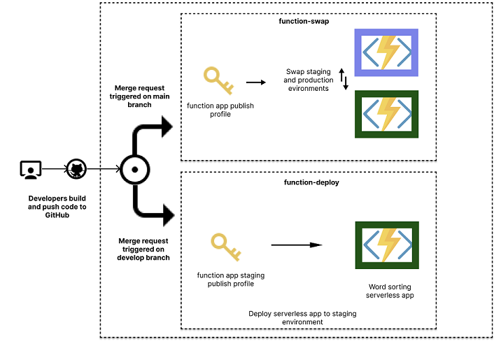

# Serverless Functions

## Training Objectives
* Create a serverless function
* Create a CI/CD pipeline for a serverless function
* Implement a Blue/Green deployment strategy for a serverless function

## Concepts
**Rate-Limiting**  
Rate-limiting is when you define and enforce the number of requests your app will respond to within a time interval. It is used to mitigate Denial-of-Service attacks (i.e., app exhaustion). It can also be used for the reasons listed below. 
* Enforce quotas
* Control the flow of data between endpoints
* Reduce cost

**Base64**  
Base64 is an encoding scheme for representing binary data in ASCII. It was developed to help transmit binary data between endpoints that can only handle text-based data. It is associated with encryption or compression. 

**Azure Function Archectype: Maven**  
The Maven Azure Function archectype includes the software needed to develop, build, and deploy a Java-based serverless function. NOTE: every Azure Function app must have a globally unique name (i.e., the "functionAppName" field within the app's "pom.xml" file). 

**Cold Start**  
A cold start is when your serverless function takes longer than usual because it has not been executed for an extended amount of time. It takes longer because the hardware allocated for it has to be powered back on. At some point, it was turned off due to inactivity.  

## Solutions
* [Setup](/devops/week-13/HOWTO.md)
* [Task 1](/devops/week-13/HOWTO.md#task-1)
* [Task 2](/devops/week-13/HOWTO.md#task-2)
* [Task 3](/devops/week-13/HOWTO.md#task-3)

## Visual Aid
